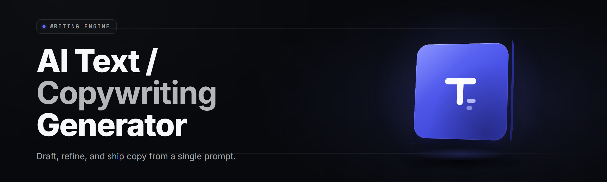

  
  
  

  

  
  
  

---

**AI Copywriting Studio 2026** — the desktop text generation suite that turns a blank page into publish-ready copy in seconds. One `.exe`, zero command line, no pip, no npm, no git. Download, extract, double-click, write.

Status · v2.4.1 · Windows x64

---

## Overview

| Category | Details |
|---|---|
| Product name | AI Copywriting Studio |
| Genre | AI text / copywriting generator (desktop) |
| Version | v2.4.1 (build 20260214) |
| Platform | Windows 10 / 11 x64, Windows Server 2019+ · Steam Deck via Proton |
| Install flow | download → extract → run `.exe` (portable, no setup wizard) |
| Output formats | Markdown, HTML, DOCX, plaintext, JSON, CSV prompt batches |
| Model backend | Local GGUF runtime + optional remote OpenAI-compatible endpoint |
| Auth needed | None for local mode; API key only for remote mode |
| License | MIT (engine), CC-BY-4.0 (templates) |

AI Copywriting Studio is a self-contained `.exe` for writers, marketers, solo founders, and content teams who want generated text on their own machine without opening a browser tab, signing into a SaaS, or wiring up a Python environment. It ships a local inference runtime, a template library, a variable-injection engine, and a batch pipeline — all behind one portable Windows executable. See FAQ for detection and update behavior.

  

---

## What is AI Copywriting Studio?

| Term | Explanation |
|---|---|
| Preset | A reusable prompt scaffold with typed slots, tone, and length constraints |
| Variable Slot | A named placeholder (`{{product}}`, `{{audience}}`) filled from a CSV or form field |
| Tone Matrix | A weighted control over formal↔casual, punchy↔measured, warm↔clinical registers |
| Batch Run | Headless generation of N outputs from a CSV of rows × a preset |
| Style Card | A saved voice profile (sentence cadence, banned words, vocabulary bias) |
| Rewrite Pass | A second generation that tightens an existing draft against a target reading level |
| Export Chain | Post-processing pipeline: markdown lint → readability score → format serialize |

---

## The Problem

- Copy tools are browser-locked, rate-limited, and forget your voice between sessions.
- Generic LLM chats generate **text**, not **formatted deliverable copy** — you still clean it by hand.
- Loud "AI writer" SaaS tools charge per seat and hide the model behind a wall you can't audit.
- No tool batches 500 product descriptions from a spreadsheet without a script or a paid API tier.
- Style is inconsistent: same prompt, different output every run, no saved voice.
- Offline workflows (planes, secure networks, countries with API region limits) break everything
  that depends on a hosted endpoint.
- You can't preview how copy reads at the *target* length, tone, and platform before shipping it.

## The Solution

| Problem | Solution |
|---|---|
| Browser-locked tools | Portable `.exe`, works offline with bundled local runtime |
| Unformatted output | Presets emit finished Markdown / HTML / DOCX, formatting included |
| Per-seat SaaS cost | One download, flat license (MIT engine) |
| No batch pipeline | Built-in Batch Run: CSV in, folder of outputs out |
| Inconsistent voice | Style Cards saved to disk, applied per project |
| Region / offline breaks | Local generation, no network round-trip required |
| No pre-flight check | Live Length & Tone Preview before export |

---

## Quick Start

1. 📄 **Visit the project page** and grab the current `.exe` bundle from the landing page.
2. 🧩 **Extract** the archive to a folder you own (not `Program Files` — the app writes Style Cards and caches next to itself).
3. ▶️ **Run** the `.exe`. First launch builds the local model cache; expect a one-time 20–40s init on an SSD.
4. ✍️ **Open a preset** from the sidebar, fill the variable slots, hit Generate.
5. 📤 **Export** — pick Markdown, HTML, or DOCX from the Export Chain menu.

---

## Comparison

| Aspect | Alternative (hosted AI writers, LLM chats) | This Tool |
|---|---|---|
| Offline use | Usually impossible | Fully offline local generation |
| Output format | Raw text, manual cleanup | Preset-defined Markdown / HTML / DOCX |
| Batch scaling | Manual or paid API | Built-in Batch Run from CSV |
| Voice consistency | Prompts reset each session | Saved Style Cards applied per project |
| Cost model | Monthly seat fee, token caps | One `.exe`, flat MIT license engine |
| Data handling | Copy leaves your machine by default | Local mode keeps it on disk |
| Template library | Starter prompts only | 39 bundled modules, editable |
| Region limits | Blocked or throttled in some regions | No region gating on local mode |

---

  

